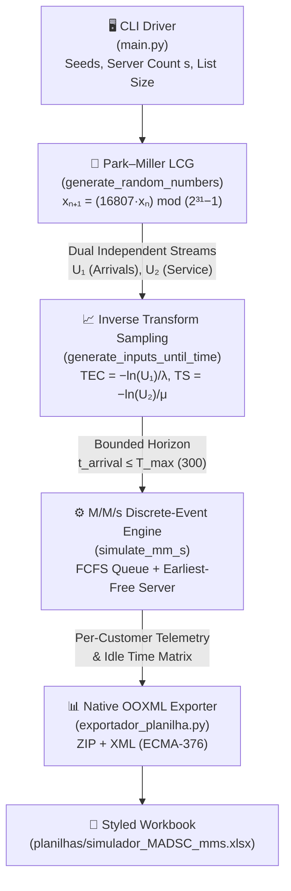

# M/M/s Queueing System Simulator
**Stochastic Modeling & Native OOXML Reporting**

> **A zero-dependency discrete-event stochastic queueing simulator written in Python** for evaluating single-queue, multi-server ($M/M/s$) service systems. Developed for the *Modeling and Evaluation of Computer Systems* (*Modelagem e Avaliação de Sistemas Computacionais*) course at **São Paulo State University (UNESP)**, the project implements a multiplicative Park–Miller pseudo-random number generator (PRNG), inverse transform exponential variate sampling, earliest-available parallel server routing, and a native `.xlsx` spreadsheet exporter built directly over the **Office Open XML (ECMA-376)** specification.

## Quick Links

* **Source Code Repository:** [github.com/joaohb07/mms-queueing-simulator](https://github.com/joaohb07/mms-queueing-simulator)
* **Author:** João Henrique Botelho ([@joaohb07](https://github.com/joaohb07))
* **Course & Institution:** Modeling and Evaluation of Computer Systems — UNESP

---

## System Architecture & Simulation Pipeline

The simulator is decoupled into three pure-Python modules with **zero third-party dependencies** (relying strictly on `math`, `zipfile`, `pathlib`, and `xml.sax.saxutils`), separating stochastic variate generation, discrete-event server scheduling, and binary Office Open XML packaging:



### Core Engineering Invariants

1. **Stream Independence via Dual Seeds:** Inter-arrival times (`TEC`) and service durations (`TS`) are driven by two decoupled PRNG streams (`seed_1` and `seed_2`), preventing cross-correlation between customer arrival bursts and workload service demands.
2. **Deterministic Replayability:** Because the Park–Miller generator is deterministic for a fixed seed pair $(x_0^{(1)}, x_0^{(2)})$, multi-server capacity scaling experiments ($s \in \{1, 2, 3, 4\}$) execute against the exact same arrival and service workload trace.
3. **Zero-Dependency Office Open XML Generation:** Rather than relying on heavy external libraries (`pandas`, `openpyxl`, or `xlsxwriter`), the reporting layer constructs the internal ZIP archive structure and XML relationships required by ISO/IEC 29500 (`[Content_Types].xml`, `_rels/.rels`, `workbook.xml`, `styles.xml`, and `sheet1.xml`).

---

## Stochastic Modeling & Queueing Theory Foundations

### 1. Kendall's Notation ($M/M/s/\infty/\text{FCFS}$)

The simulated system models a **single-queue, multi-server Markovian facility** characterized by:

* **Arrival Process ($M$ — Markovian / Poisson):** Customer arrivals follow a homogeneous Poisson process with arrival rate $\lambda = 0.5\text{ customers / time unit}$, yielding exponentially distributed inter-arrival times ($\text{TEC}$) with mean:

$$
E[\text{TEC}] = \frac{1}{\lambda} = \frac{1}{0.5} = 2.0\text{ time units}
$$

* **Service Process ($M$ — Exponential):** Each of the $s$ identical parallel servers processes customers with service rate $\mu = 0.125\text{ customers / time unit}$, yielding exponentially distributed service times ($\text{TS}$) with mean:

$$
E[\text{TS}] = \frac{1}{\mu} = \frac{1}{0.125} = 8.0\text{ time units}
$$

* **Parallel Servers ($s$):** Configurable number of homogeneous servers ($s \ge 1$) fed by a single First-Come, First-Served (FCFS) queue with infinite buffer capacity.

### 2. Traffic Intensity & Theoretical Stability Criterion

Under steady-state queueing theory, offered load $a$ and per-server utilization factor $\rho$ are governed by:

$$
a = \frac{\lambda}{\mu} = \frac{0.5}{0.125} = 4.0\text{ Erlangs}, \qquad \rho = \frac{\lambda}{s \cdot \mu} = \frac{4.0}{s}
$$

| Configuration | Servers ($s$) | Traffic Intensity ($\rho = \frac{\lambda}{s\mu}$) | Analytical Regime ($T \to \infty$) | Finite-Horizon Simulation ($T_{\max} = 300$) |
| :--- | :---: | :---: | :--- | :--- |
| **$M/M/1$** | $1$ | $\rho = 4.00 > 1$ | **Unstable (Queue diverges)** | Server saturated ($\approx 0\%$ idle); waiting time grows monotonically |
| **$M/M/2$** | $2$ | $\rho = 2.00 > 1$ | **Unstable (Overloaded)** | Severe queue buildup; servers remain continuously busy |
| **$M/M/3$** | $3$ | $\rho = 1.33 > 1$ | **Unstable (Overloaded)** | Moderate backlog accumulation across simulation horizon |
| **$M/M/4$** | $4$ | $\rho = 1.00$ | **Critically Loaded** | Near-equilibrium capacity ($s\mu = \lambda = 0.5$) |
| **$M/M/5+$** | $\ge 5$ | $\rho \le 0.80 < 1$ | **Ergodic Steady State** | Bounded queue lengths and measurable inter-arrival server idleness |

---

## Pseudo-Random Number Generation & Variate Sampling

### 1. Park–Miller Minimal Standard LCG (`generate_random_numbers`)

Uniform pseudo-random variates $U_i \in (0, 1)$ are generated via the multiplicative **Lehmer / Park–Miller Linear Congruential Generator**:

$$
x_{i+1} = (a \cdot x_i + c) \bmod M, \qquad U_i = \frac{x_i}{M}
$$

with prime modulus and primitive root parameters:

$$
a = 16807 = 7^5, \qquad c = 0, \qquad M = 2^{31} - 1 = 2\,147\,483\,647
$$

This parametrization guarantees a full maximal period of $M - 1 = 2^{31} - 2$ non-zero states before sequence repetition. Sequence indexing starts at offset `list_position = 2` to maintain exact numerical parity with analytical hand-calculation benchmarks.

### 2. Inverse Transform Sampling (`generate_inputs_until_time`)

To map uniform variates $U \sim \mathcal{U}(0, 1)$ onto an exponential cumulative distribution function $F(x) = 1 - e^{-\alpha x}$ ($\alpha \in \{\lambda, \mu\}$), the simulator applies the inverse CDF transformation $X = F^{-1}(U)$:

$$
\text{TEC}_i = -\frac{\ln(U_i^{(1)})}{\lambda} = -\frac{\ln(U_i^{(1)})}{0.5}, \qquad \text{TS}_i = -\frac{\ln(U_i^{(2)})}{\mu} = -\frac{\ln(U_i^{(2)})}{0.125}
$$

Arrival timestamps $A_i$ accumulate sequentially until the simulation horizon $T_{\max} = 300$ is exceeded ($A_i > T_{\max}$), at which point arrival generation terminates cleanly.

---

## Discrete-Event Scheduling & Metrics Formulation (`simulate_mm_s`)

For each customer $i \in \{1, \dots, N\}$ arriving at clock time $A_i$ with service duration $\text{TS}_i$:

1. **Earliest-Available Server Selection (Tie-Breaking Rule):**
   Let $F_k$ denote the timestamp when server $k \in \{1, \dots, s\}$ completes its currently assigned job (initialized to $F_k = 0$). Customer $i$ is routed to server $k^*$:

   $$
   k^* = \arg\min_{k \in \{1, \dots, s\}} F_k
   $$

   Python's `min(range(server_count), key=...)` preserves index ordering, deterministically breaking ties in favor of the lowest-numbered server ID.

2. **Service Window & Customer Latency Metrics:**

   $$
   \begin{aligned}
   T_{\text{start}, i} &= \max(A_i, F_{k^*}) \\
   T_{\text{end}, i}   &= T_{\text{start}, i} + \text{TS}_i \\
   W_{q, i}            &= T_{\text{start}, i} - A_i \quad \text{(Queue Waiting Time)} \\
   W_i                 &= T_{\text{end}, i} - A_i \quad \text{(Total Sojourn / System Time)}
   \end{aligned}
   $$

3. **Per-Server & Horizon-Bounded Idle Time Accounting:**
   * **Pre-Service Idle Gap:** When $A_i > F_{k^*}$, server $k^*$ accumulates idle time $I_{i, k^*} = \max(0, A_i - F_{k^*})$, recorded both in the sparse customer-by-server idle matrix and in the server's cumulative accumulator.
   * **Post-Completion Residual Idleness:** Once all $N$ arrivals have been scheduled, any remaining idle interval between each server's final service completion $F_k$ and the simulation horizon $T_{\max} = 300$ is added:

   $$
   I_{\text{final}, k} = \max(0, T_{\max} - F_k), \qquad I_{\text{total}, k} = \sum_{i=1}^{N} I_{i, k} + I_{\text{final}, k}
   $$

---

## Native Office Open XML (`.xlsx`) Exporter (`exportador_planilha.py`)

Instead of introducing external spreadsheet dependencies, `export_spreadsheet()` synthesizes a compliant **ECMA-376 / ISO-29500 `.xlsx` package** from scratch using Python's `zipfile` module:

```text
planilhas/simulador_MADSC_mms.xlsx (ZIP Archive)
├── [Content_Types].xml          # MIME type overrides for workbook, worksheet, and stylesheet parts
├── _rels/.rels                  # Root package relationship pointing to xl/workbook.xml
└── xl/
    ├── workbook.xml             # Defines the "Simulador" worksheet entry
    ├── styles.xml               # Custom 5-decimal format (numFmtId="164": 0.00000), fonts, fills & borders
    ├── _rels/workbook.xml.rels  # Links workbook to worksheets/sheet1.xml and styles.xml
    └── worksheets/sheet1.xml    # Sparse cell grid (<c r="C2" s="3"><v>...</v></c>) + summary averages row
```

### Spreadsheet Schema & Dynamic Column Expansion

* **Columns `A`–`J` (Fixed Customer Telemetry):** Customer Index, Assigned Server ID, `TEC`, `TS`, Arrival Clock Time, Service Start, Service End, Queue Wait Time ($W_q$), System Time ($W$), and Active Server Idle Time.
* **Columns `K`–`K+s-1` (Dynamic Server Idle Matrix):** Dynamically expands to $s$ columns (`Tempo ocioso Servidor 1` .. `Tempo ocioso Servidor s`), mapping each customer's idle gap to the exact server column and appending a styled summary row (`Média`) at row `client_size + 3`.

---

## Repository Structure

```text
mms-queueing-simulator/
├── main.py                   # Interactive CLI driver, input validation & experiment orchestrator
├── simulador_mms.py          # Park–Miller LCG, exponential variate generator & M/M/s event engine
├── exportador_planilha.py    # Zero-dependency Office Open XML (.xlsx) builder & styling engine
├── planilhas/                # Auto-generated output directory for simulador_MADSC_mm{s}.xlsx
└── README.md                 # Project overview, mathematical equations & usage instructions
```

---

## Execution & Reference Benchmarks

### Prerequisites

* **Python 3.8+** (Standard Library only — no `pip install` required).

### Running a Simulation Experiment

```bash
# Clone the repository
git clone https://github.com/joaohb07/mms-queueing-simulator.git
cd mms-queueing-simulator

# Run the interactive simulator
python3 main.py
```

### Sample Interactive Session ($M/M/2$ Configuration)

```text
Enter seed 1: 10
Enter seed 2: 11
Enter the number of servers: 2
Enter the size of pseudorandom list: 1000
Exported spreadsheet: planilhas/simulador_MADSC_mm2.xlsx
```

Running comparative sweeps with fixed seeds (`seed_1 = 10`, `seed_2 = 11`, `random_list_size = 1000`) across `server_count` $= 1, 2, 3, 4$ generates `simulador_MADSC_mm1.xlsx` through `simulador_MADSC_mm4.xlsx` for direct cross-configuration performance evaluation.