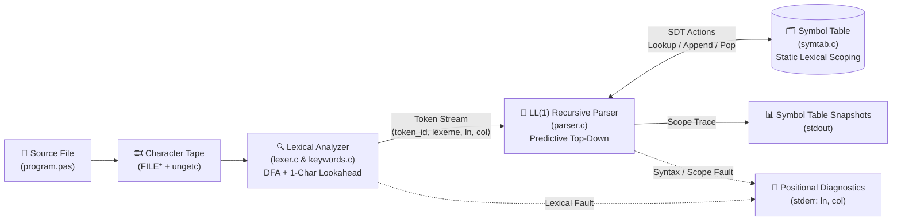

# MyPas Compiler
> Recursive Descent LL(1) Pascal Compiler

<p align="left">
  <a href="https://github.com/joaohb07/mypas" target="_blank">
    
  </a>
  
  
  
  
</p>

> **MyPas** is a modular, single-pass compiler front-end written in C for a statically typed subset of the **Pascal** programming language. Developed for the *Compilers* course at **São Paulo State University (UNESP)** under the supervision of **Prof. Dr. Eraldo Pereira Marinho**, the project implements lexical scanning via deterministic finite automata (DFA), predictive top-down $\text{LL}(1)$ recursive descent parsing, and syntax-directed semantic validation backed by a block-structured symbol table with static lexical scoping (`lexlevel`).

---

## Quick Links

* **Source Code Repository:** [github.com/joaohb07/mypas](https://github.com/joaohb07/mypas)
* **Authors:** João Henrique Botelho, Cristian Santos de Castro, João Pedro Brum Terra
* **Course & Institution:** Compilers (2024) — UNESP (Prof. Dr. Eraldo Pereira Marinho)

---

## System Architecture & Compilation Pipeline

Unlike multi-pass compilers that materialize an intermediate Abstract Syntax Tree (AST) before performing name and type resolution, **MyPas** operates as a **single-pass, syntax-directed translation (SDT) front-end**. Semantic actions—symbol insertion, duplicate detection, lexical visibility lookup, and scope-frame reclamation—are embedded directly within the mutually recursive grammar procedures.



### Core Architectural Invariants

1. **Zero-Dependency C Implementation:** Built strictly on the C Standard Library (`<stdio.h>`, `<stdlib.h>`, `<string.h>`, `<ctype.h>`) without external lexer or parser generators (`lex`/`flex` or `yacc`/`bison`).
2. **Deterministic Single-Token Lookahead ($k = 1$):** A global `lookahead` register holds the current unconsumed terminal returned by `gettoken(source)`. Every non-terminal procedure inspects `lookahead` to select a unique production rule in $\mathcal{O}(1)$ time with zero backtracking.
3. **Synchronized Source-Coordinate Tracking:** The lexical scanner maintains global `linenum` and `colnum` state across whitespace, tab stops (`+4` columns), and multi-line comments, enabling exact `(ln, col)` fault reporting across all compilation phases.

---

## Formal Language Theory Foundations

The front-end design directly maps each compilation phase to its corresponding formal language class in the **Chomsky Hierarchy**:

### 1. Lexical Layer — Chomsky Type-3 (Regular Languages)

Implemented across `lexer.c` and `keywords.c`, the scanner simulates a **Deterministic Finite Automaton (DFA)** over an input character tape (`FILE *`) augmented with single-character rollback (`ungetc()`).

* **Whitespace & Comment Filtering (`skipspaces`):** Consumes spaces, tabs, newlines (`linenum++`, `colnum = 1`), and block comments delimited by `{ ... }` or `(* ... *)`. Reaching `EOF` inside an unclosed comment triggers a fatal `UNTERMINED_COMMENT_ERROR` reporting the opening line.
* **Maximal-Munch Identifiers & Case-Insensitive Keywords (`isID` & `iskeyword`):**
  $$\text{ID} = [A\text{-}Za\text{-}z][A\text{-}Za\text{-}z0\text{-}9]^{*}, \quad |\text{lexeme}| \le \text{MAXIDLEN}\;(32)$$
  Identifiers are scanned greedily until the first non-alphanumeric character (pushed back via `ungetc`). Because Pascal is case-insensitive, `iskeyword()` normalizes a local buffer (`char identifier[MAXIDLEN + 1]`) to lowercase via `tolower()` and checks the reserved keyword table (`BEGIN` through `END`), promoting matching lexemes from generic `ID` tokens to keyword token codes while preserving original casing for symbol table diagnostics.
* **Multi-Character Operators & Numeric Literals:**
  * `isASGN` disambiguates the assignment operator `:=` (`ASGN`) from standalone declaration colons `:`.
  * `isRELOP` resolves single- and two-character relational operators (`=`, `<>`, `<=`, `>=`, `<`, `>`), rolling back the second character when a single-character `<` or `>` is matched.
  * `isNUM` recognizes integer and floating-point numeric constants (`[0-9]+(\.[0-9]+)?([eE][+-]?[0-9]+)?`).

### 2. Syntactic Layer — Chomsky Type-2 ($\text{LL}(1)$ Context-Free Grammar)

Implemented in `parser.c`, the syntactic analyzer is structured as a set of mutually recursive procedures—one per non-terminal—operating on a left-factored, non-left-recursive $\text{LL}(1)$ grammar.

#### Extended Backus–Naur Form (EBNF) Specification

```ebnf
program   ::= "PROGRAM" ID "(" idlist ")" ";" block "." ;

block     ::= vardef sbprgdef beginend ;

vardef    ::= [ "VAR" idlist ":" type ";" { idlist ":" type ";" } ] ;

sbprgdef  ::= { ( "PROCEDURE" | "FUNCTION" ) ID parmlist [ ":" type ] ";" block ";" } ;

parmlist  ::= [ "(" [ "VAR" ] idlist ":" type { ";" [ "VAR" ] idlist ":" type } ")" ] ;

beginend  ::= "BEGIN" stmtlst "END" ;

stmtlst   ::= stmt { ";" stmt } ;

stmt      ::= idstmt
            | beginend
            | ifstmt
            | whlstmt
            | repstmt
            | ε ;

idstmt    ::= ID [ ":=" expr | "(" exprlist ")" ] ;

ifstmt    ::= "IF" expr "THEN" stmt [ "ELSE" stmt ] ;

whlstmt   ::= "WHILE" expr "DO" stmt ;

repstmt   ::= "REPEAT" stmtlst "UNTIL" expr ;

exprlist  ::= expr { "," expr } ;

expr      ::= smpexpr [ relop smpexpr ] ;

smpexpr   ::= [ "+" | "-" ] term { ( "+" | "-" ) term } ;

term      ::= factor { ( "*" | "/" ) factor } ;

factor    ::= ID [ "(" exprlist ")" ]
            | NUM
            | "(" expr ")" ;

relop     ::= "=" | "<>" | "<=" | ">=" | "<" | ">" ;

type      ::= "INTEGER" | "LONG" | "REAL" | "DOUBLE" | "BOOLEAN" ;
```

#### Operator Precedence & Associativity Hierarchy

Operator precedence and left-associativity are encoded directly into the recursive non-terminal call chain rather than an external operator-precedence table:

| Precedence | Non-Terminal | Operators / Constructs | Associativity |
| :--- | :--- | :--- | :--- |
| **1 (Lowest)** | `expr` | `=`, `<>`, `<=`, `>=`, `<`, `>` | Non-associative |
| **2** | `smpexpr` | Unary `+`, `-` and binary `+`, `-` | Left-associative (`while` loop) |
| **3** | `term` | `*`, `/` | Left-associative (`while` loop) |
| **4 (Highest)** | `factor` | Parenthesized `( expr )`, function calls `ID(...)`, literals `NUM` | Atomic |

* **Predictive Token Matching (`match`):** Verifies `lookahead == expected` and advances the scanner via `lookahead = gettoken(source)`. On mismatch, it emits `SYNTAX_ERROR` with the offending lexeme, `linenum`, and `colnum`, halting execution immediately (`exit(-3)`).
* **Dangling-Else Disambiguation:** In `ifstmt()`, the optional `if (lookahead == ELSE)` branch eagerly binds to the innermost unmatched `IF` statement, matching standard Pascal semantics.

---

## Symbol Table & Static Lexical Scoping (`symtab.c`)

To support arbitrarily nested `PROCEDURE` and `FUNCTION` declarations, **MyPas** manages a contiguous stack-allocated symbol table (`SYMTAB symtab[MAXSTBSIZE]`) indexed by a stack pointer `symtab_next_entry`.

### Symbol Descriptor Structure (`SYMTAB`)

```c
typedef struct _symtab_ {
    char name[MAXIDLEN + 1]; // Original identifier lexeme (up to 32 chars + NUL)
    int  lexlevel;           // Static nesting depth (1 = global, 2+ = nested subprograms)
    int  objtype;            // 0 = OBJ_PROCEDURE, 1 = OBJ_FUNCTION, 2 = OBJ_VAR
    int  parmflag;           // 1 = formal/program parameter, 0 = local/global variable
    int  type;               // 0 = INT32, 1 = INT64, 2 = FLOAT32, 3 = FLOAT64, 4 = BOOL, 5 = TEXT
} SYMTAB;
```

### Lexical Level Lifecycle & $\mathcal{O}(1)$ Frame Reclamation

1. **Global Scope (`lexlevel = 1`):**
   * Program header arguments (e.g., `input`, `output`) are registered at `lexlevel = 1` with `objtype = OBJ_VAR`, `parmflag = 1`, and `type = TEXT`.
   * Top-level `VAR` declarations and subprogram headers are appended at `lexlevel = 1`.
2. **Subprogram Entry (`lexlevel` $\rightarrow$ `lexlevel + 1`):**
   * Inside `sbprgdef()`, the subprogram's own identifier is inserted at the **enclosing** `lexlevel` (so outer callers can invoke it) and its index is recorded in `first_func_pro_index`.
   * Immediately after `match(ID)`, `lexlevel` is incremented (`lexlevel++`) prior to parsing `parmlist()`, ensuring formal parameters and local variables bind to the inner scope (`lexlevel + 1`).
3. **Subprogram Exit & Stack Teardown:**
   * After parsing the subprogram's `block()` and trailing `;`, `symtab_print()` outputs a snapshot of the active symbol table.
   * All formal parameters and local declarations belonging to the exiting subprogram are popped in $\mathcal{O}(1)$ time by resetting the stack pointer and decrementing the lexical depth:
     ```c
     symtab_next_entry = first_func_pro_index + 1;
     lexlevel--;
     ```

### Visibility & Lookup Semantics (`symtab_lookup`)

* **Lexical Visibility Rule:** When resolving an identifier in `idstmt()` or `factor()`, `symtab_lookup(lexeme, lexlevel)` permits access to variables declared in the current or any enclosing lexical scope (`symtab[i].lexlevel <= lexlevel`), as well as visible procedures and functions. Undeclared references trigger `SYMBOL_NOT_FOUND_ERROR`.
* **Duplicate Detection:** `symtab_append()` checks for existing collisions before inserting a new symbol, reporting `SYMBOL_ALREADY_DEFINED_ERROR` and incrementing `error_count` on redeclaration.

---

## Repository Structure & Module Breakdown

```text
mypas/
├── constants.h                 # Architectural limits (MAXIDLEN = 32) & error format strings
├── keywords.h / keywords.c     # Reserved keyword table & case-insensitive lookup
├── lexer.h / lexer.c           # DFA scanner, comment stripper, and (ln, col) tracker
├── parser.h / parser.c         # Predictive LL(1) recursive descent parser & SDT actions
├── symtab.h / symtab.c         # Block-structured symbol table & lexical scope lookup
├── mypas.c                     # CLI driver, argument/file validation, and entry point
├── Makefile                    # GNU Make build automation (CFLAGS = -I. -g)
└── inputs/                     # Regression suite of valid and faulty .pas programs
```

| Module | Primary Responsibility & Key Functions |
| :--- | :--- |
| `mypas.c` | Validates CLI arguments (`argc == 2`) and `.pas` extension, opens `FILE *source` with error checking, primes `lookahead = gettoken(source)`, invokes `program()`, and prints `symtab final`. |
| `constants.h` | Defines `MAXIDLEN` (`32`), stack/table capacities, and diagnostic message templates (`SYNTAX_ERROR`, `SYMBOL_NOT_FOUND_ERROR`, `SYMBOL_ALREADY_DEFINED_ERROR`, `UNTERMINED_COMMENT_ERROR`). |
| `keywords.c / .h` | Maps lowercase-normalized identifiers against Pascal reserved keywords (`BEGIN`..`END`) via `iskeyword()`. |
| `lexer.c / .h` | Implements `skipspaces()`, `isID()`, `isNUM()`, `isASGN()`, `isRELOP()`, and `gettoken()`, maintaining `lexeme`, `linenum`, and `colnum`. |
| `parser.c / .h` | Implements all $\text{LL}(1)$ recursive descent procedures (`program`, `block`, `vardef`, `sbprgdef`, `parmlist`, `beginend`, `stmtlst`, `stmt`, `expr`, `smpexpr`, `term`, `factor`, `type`) and `match()`. |
| `symtab.c / .h` | Implements `symtab_append()`, `symtab_lookup()`, and formatted tabular inspection via `symtab_print()`. |

---

## Compilation & Execution

### Prerequisites

* **GCC** or **Clang** (C99/C11 compatible)
* **GNU Make**

### Build & Run Commands

```bash
# Clone the repository
git clone https://github.com/joaohb07/mypas.git
cd mypas

# Compile the mypas executable
make

# Run against a valid multi-level nested scope program
./mypas inputs/relop.pas

# Run against a syntax error test case
./mypas inputs/repeat-until-erro.pas

# Clean object files (*.o) or all build artifacts
make clean
make mostlyclean
```

---

## Execution Traces & Verification

### 1. Multi-Level Lexical Scoping (`inputs/relop.pas`)

Executing `./mypas inputs/relop.pas` parses a program containing three nested lexical levels (`Global` $\rightarrow$ `CompareValues` $\rightarrow$ `CheckEqual` / `CheckGreaterOrEqual`), printing intermediate symbol table states as each inner block exits and unwinding inner frames back to `lexlevel = 1`:

```text
symtab after block:
#  | NAME                              | LEXLEVEL | OBJECT TYPE |   TYPE   | IS PARAM? 
-------------------------------------------------------------------------------------
0  | input                             | 1        | variable    | text     | yes 
1  | output                            | 1        | variable    | text     | yes 
2  | x                                 | 1        | variable    | int32    | no 
3  | y                                 | 1        | variable    | int32    | no 
4  | CompareValues                     | 1        | procedure   | int32    | no 
5  | a                                 | 2        | variable    | int32    | yes 
6  | b                                 | 2        | variable    | int32    | yes 
7  | isEqual                           | 2        | variable    | boolean  | no 
8  | isGreater                         | 2        | variable    | boolean  | no 
9  | CheckEqual                        | 2        | function    | boolean  | no 
10 | CheckGreaterOrEqual               | 2        | function    | boolean  | no 

symtab final:
#  | NAME                              | LEXLEVEL | OBJECT TYPE |   TYPE   | IS PARAM? 
-------------------------------------------------------------------------------------
0  | input                             | 1        | variable    | text     | yes 
1  | output                            | 1        | variable    | text     | yes 
2  | x                                 | 1        | variable    | int32    | no 
3  | y                                 | 1        | variable    | int32    | no 
4  | CompareValues                     | 1        | procedure   | int32    | no 
```

### 2. Positional Syntax Error Detection (`inputs/repeat-until-erro.pas`)

When encountering a malformed `REPEAT ... UNTIL` block missing a statement delimiter before a trailing assignment, the parser immediately reports the offending token and exact source coordinates:

```text
ERROR: Incorrect syntax near "count".   (ln:7, col:19)
```

### 3. Diagnostic Test Matrix (`inputs/`)

| Test Case | Phase | Fault / Scenario Tested | Expected Compiler Behavior |
| :--- | :--- | :--- | :--- |
| `relop.pas` | End-to-End | 3-level nested procedures/functions & relational ops | Prints progressive scope frames and clean `symtab final` |
| `lexlevel-3.pas` | Semantic | Deep lexical scope variable resolution (`lexlevel <= current`) | Resolves outer variables across 3 nested levels |
| `comentario-erro.pas` | Lexical | Unclosed `{` block comment reaching `EOF` | Emits `UNTERMINED_COMMENT_ERROR` with opening line |
| `identificador-muito-longo.pas` | Lexical | Identifier exceeding `MAXIDLEN` ($32$ characters) | Emits `IDENTIFIER_NAME_ERROR` with `(ln, col)` |
| `repeat-until-erro.pas` | Syntactic | Unexpected identifier following `UNTIL` expression | Emits `SYNTAX_ERROR` at `(ln:7, col:19)` and exits `-3` |
| `tipos-erro.pas` | Syntactic | Invalid or unsupported variable data type keyword | Emits `SYNTAX_ERROR` expecting valid `type` non-terminal |

---

## References

1. **Aho, A. V., Lam, M. S., Sethi, R., & Ullman, J. D.** *Compilers: Principles, Techniques, and Tools* (2nd ed.). Addison-Wesley, 2006.
2. **Wirth, N.** *Compiler Construction*. Addison-Wesley, 1996.
3. **Louden, K. C.** *Compiler Construction: Principles and Practice*. PWS Publishing, 1997.