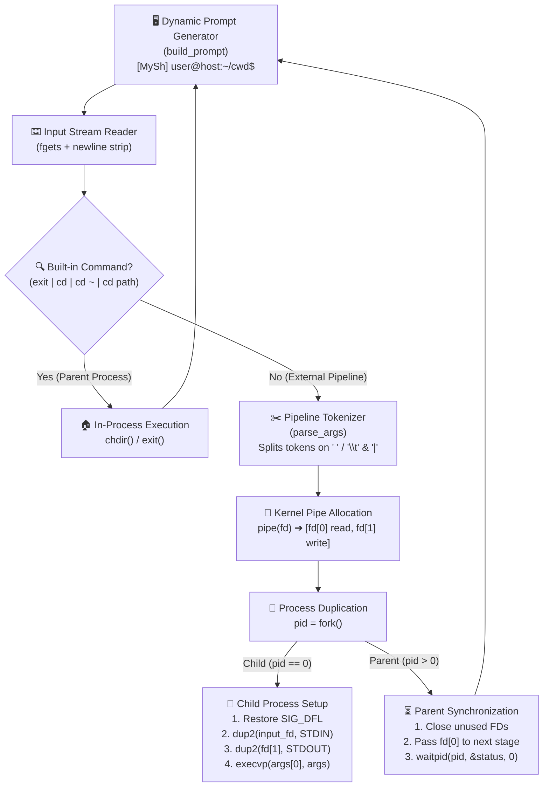

# MySh Command-Line Shell
**Custom POSIX Command-Line Shell in C**

> **A lightweight, POSIX-compliant interactive command-line interpreter implemented in C11** from first principles using UNIX system calls. Developed for the *Operating Systems II* (*Sistemas Operacionais II*) course at **São Paulo State University (UNESP)**, **MySh** demonstrates kernel-level process lifecycle orchestration (`fork`, `execvp`, `waitpid`), unidirectional inter-process communication (`pipe`, `dup2`), asynchronous terminal signal isolation (`SIGINT`, `SIGTSTP`), and parent-process built-in state management (`chdir`).

## Quick Links

* **Source Code Repository:** [github.com/joaohb07/shell-c](https://github.com/joaohb07/shell-c)
* **Authors:** João Henrique Botelho ([@joaohb07](https://github.com/joaohb07)), João Victor Figueredo, Paulo Santos
* **Course & Institution:** Operating Systems II — UNESP

---

## System Architecture & REPL Execution Pipeline

**MySh** operates as an infinite **Read–Eval–Print Loop (REPL)** executing in user space while delegating process isolation, file-descriptor redirection, and binary loading directly to the OS kernel via POSIX system calls:



### Core Operating Systems Invariants

1. **Parent vs. Child State Separation:** State-mutating shell built-ins (`cd`, `exit`) **must** execute inside the parent shell process. Invoking `chdir()` inside a forked child would alter only the child's process control block (`PCB`) current working directory, leaving the parent shell's directory unchanged upon child termination.
2. **Strict File Descriptor Hygiene:** Every open pipe endpoint (`fd[0]` and `fd[1]`) not actively bound to `STDIN_FILENO` (`0`) or `STDOUT_FILENO` (`1`) is closed immediately in both parent and child processes. Failing to close the write end (`fd[1]`) in the parent prevents downstream consumers (e.g., `grep`, `wc`, `sort`) from receiving `EOF` (`read() == 0`), which would otherwise cause pipeline deadlocks.
3. **Cross-Platform POSIX Portability:** Preprocessor guards provide fallback definitions for `LOGIN_NAME_MAX`, `HOST_NAME_MAX`, and `PATH_MAX` across Linux (`glibc`) and macOS/BSD (`Darwin`) toolchains.

---

## Kernel Mechanics & POSIX System Call Breakdown

### 1. Process Lifecycle & Image Replacement (`fork`, `execvp`, `waitpid`)

When executing an external binary (e.g., `ls -la`), **MySh** follows the classic UNIX fork–exec–wait pattern inside `run_command()`:

1. **`fork()`:** Clones the calling shell process, creating a child process with a distinct PID and a copy-on-write (CoW) replica of the parent's virtual address space and open file descriptor table.
2. **`execvp(args[0], args)`:** Replaces the child's entire memory image (`.text`, `.data`, `.bss`, heap, and stack) with the target executable resolved across the colon-delimited directories in the `$PATH` environment variable, preserving the redirected file descriptors `0`, `1`, and `2`.
3. **`waitpid(pid, &status, 0)`:** Suspends the parent REPL until the foreground child terminates, reaping the child's exit status from the kernel process table to prevent **zombie processes** (`Z` state) and inspecting termination causes via `WIFEXITED(status)` and `WIFSIGNALED(status)`.

### 2. Multi-Stage Pipeline Plumbing (`pipe`, `dup2`)

For arbitrary $k$-stage command pipelines (`cmd_1 | cmd_2 | ... | cmd_k`), `parse_args()` iterates through whitespace-delimited tokens and chains consecutive stages using unidirectional kernel ring buffers:

| Pipeline Stage | `input_fd` (`STDIN_FILENO`) | `has_next_pipe` | `STDOUT_FILENO` Target | Parent Action After `fork()` |
| :--- | :--- | :--- | :--- | :--- |
| **Stage 1 (`cmd_1`)** | `STDIN_FILENO` (`0`) | `1` (`true`) | `dup2(fd₁[1], 1)` | Closes `fd₁[1]`; stores `next_input_fd = fd₁[0]` |
| **Stage $m$ (`cmd_m`)** | `dup2(fdₘ₋₁[0], 0)` | `1` (`true`) | `dup2(fdₘ[1], 1)` | Closes `fdₘ₋₁[0]` and `fdₘ[1]`; updates `next_input_fd = fdₘ[0]` |
| **Stage $k$ (`cmd_k`)** | `dup2(fdₖ₋₁[0], 0)` | `0` (`false`) | Terminal `STDOUT_FILENO` (`1`) | Closes `fdₖ₋₁[0]`; awaits final exit status |

### 3. Asynchronous Signal Isolation (`SIGINT` & `SIGTSTP`)

Interactive shells must remain resilient to keyboard-generated terminal signals sent to the foreground process group:

* **Parent Shell (`main`):** Registers a no-op signal handler (`ignore_signals`) for `SIGINT` (`Ctrl+C`) and `SIGTSTP` (`Ctrl+Z`), ensuring accidental interrupt keystrokes do not terminate or suspend the active shell session.
* **Child Processes (`pid == 0`):** Explicitly resets both handlers to kernel defaults (`signal(SIGINT, SIG_DFL)` and `signal(SIGTSTP, SIG_DFL)`) prior to calling `execvp()`, allowing users to interrupt or suspend long-running foreground commands (e.g., `cat`, `sleep 30`, `ping`) normally.

### 4. Context-Aware Prompt & Heap Safety (`build_prompt`)

Before each prompt render, `build_prompt()` queries user identity (`getlogin_r` with `$USER` fallback), network hostname (`gethostname`), and working directory (`getcwd`), substituting the `$HOME` prefix with `~` via `memmove()` to render:

```text
[MySh] <username>@<hostname>:<abbreviated_cwd>$
```

The dynamically allocated prompt buffer is freed (`free(prompt)`) immediately after `fflush(stdout)` on every REPL cycle, maintaining zero heap memory leaks across long-running interactive sessions.

---

## Repository Structure

```text
shell-c/
├── mysh.c          # Complete POSIX shell implementation (REPL, tokenizer, pipe/fork engine, signal handlers)
├── Makefile        # GNU Make build rules (-Wall -Wextra -std=c11 -D_POSIX_C_SOURCE=200809L)
├── .gitignore      # Excludes compiled binaries (mysh, a.out) and debug artifacts
└── README.md       # Architectural overview, system call breakdown & usage instructions
```

---

## Compilation & Interactive Verification

### Prerequisites

* **GCC** or **Clang** (C11 & POSIX.1-2008 compatible environment: Linux or macOS)
* **GNU Make**

### Build & Run

```bash
# Clone the repository
git clone https://github.com/joaohb07/shell-c.git
cd shell-c

# Compile with strict POSIX warnings enabled
make

# Launch the interactive shell
./mysh
```

### Sample Execution Trace

```text
[MySh] bots@MacBook-Pro:~/Documents/repos/shell-c$ ls -la | grep mysh | wc -l
       2
[MySh] bots@MacBook-Pro:~/Documents/repos/shell-c$ cd ..
[MySh] bots@MacBook-Pro:~/Documents/repos$ pwd
/Users/bots/Documents/repos
[MySh] bots@MacBook-Pro:~/Documents/repos$ cd ~
[MySh] bots@MacBook-Pro:~$ sleep 10
^C
[MySh] bots@MacBook-Pro:~$ exit
```

*(Notice how `^C` (`SIGINT`) cleanly terminates the foreground `sleep 10` child process while returning control immediately to the `[MySh]` prompt).*