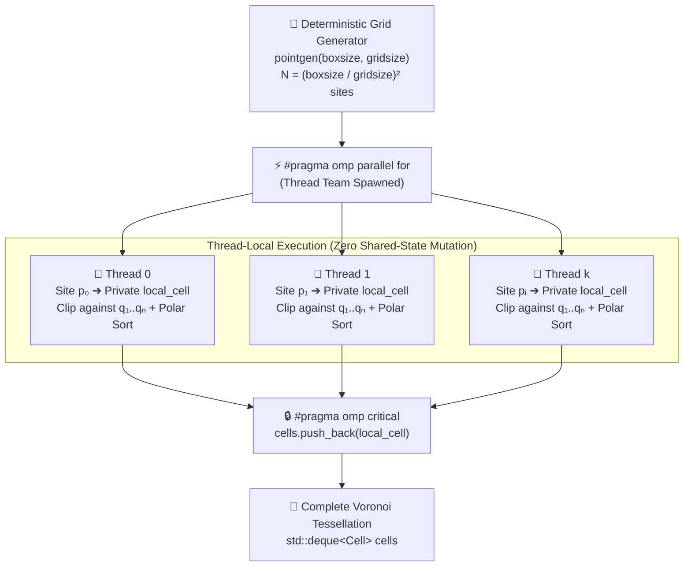

# Parallel Voronoi Diagram
**Computational Geometry & Shared-Memory HPC**

<p align="left">
  <a href="https://github.com/joaohb07/programacao-paralela-e-distribuida" target="_blank">
    
  </a>
  
  
  
</p>

> **A high-performance C++ implementation of planar Voronoi tessellation** built from first principles using half-plane intersection clipping and **OpenMP** shared-memory multithreading. Developed for the *Parallel and Distributed Programming* course at **São Paulo State University (UNESP)**, the project explores both exact geometric construction and empirical concurrency trade-offs across sequential, outer-loop parallel, and nested-loop parallel execution models.

---

## Quick Links

* **Source Code Repository:** [github.com/joaohb07/programacao-paralela-e-distribuida](https://github.com/joaohb07/programacao-paralela-e-distribuida)
* **Authors:** João Henrique Botelho (`201154048`), João Vitor Figueredo (`201154072`), João Pedro Brum (`201152428`)
* **Course & Institution:** Parallel and Distributed Programming — UNESP

---

## Mathematical & Computational Geometry Foundations

### 1. Planar Voronoi Tessellation Definition

Given a finite set of $n$ distinct generator sites $S = \{p_1, p_2, \dots, p_n\} \subset \mathbb{R}^2$ bounded within a closed rectangular domain $\Omega = [0, L] \times [0, L]$, the **Voronoi cell** $V(p_i)$ associated with site $p_i$ is the locus of all points in $\Omega$ closer to $p_i$ than to any other site $p_j \in S \setminus \{p_i\}$ under the Euclidean metric $d(x, y) = \|x - y\|_2$:

$$
V(p_i) = \left\{ x \in \Omega \;\middle|\; \|x - p_i\|_2 \le \|x - p_j\|_2, \;\forall j \neq i \right\}
$$

Geometrically, each cell $V(p_i)$ is a **convex polygon** formed by the intersection of the bounding box $\Omega$ with $n - 1$ closed half-planes:

$$
V(p_i) = \Omega \cap \bigcap_{j \neq i} H(p_i, p_j)
$$

where $H(p_i, p_j)$ denotes the half-plane containing $p_i$ bounded by the **perpendicular bisector** $B(p_i, p_j)$.

---

### 2. Analytical Half-Plane Clipping Pipeline

Instead of relying on Fortune's sweep-line algorithm or Delaunay dualization, the implementation computes each cell independently via **incremental convex polygon clipping** (`New_Cell`), making every site's cell construction data-independent from all other sites:

#### A. Perpendicular Bisector Line Equation (`Get_Bisector`)

For two generator sites $A = (x_A, y_A)$ and $B = (x_B, y_B)$, let $M = \left(\frac{x_A + x_B}{2}, \frac{y_A + y_B}{2}\right)$ be their midpoint. The normal vector $\vec{n} = B - A = (x_B - x_A, y_B - y_A)$ defines the implicit line equation $ax + by + c = 0$:

$$
\begin{aligned}
a &= x_B - x_A \\
b &= y_B - y_A \\
c &= -a \cdot \left(\frac{x_A + x_B}{2}\right) - b \cdot \left(\frac{y_A + y_B}{2}\right)
\end{aligned}
$$

#### B. Line–Segment Intersection via Homogeneous Cross Product (`intersec_Bi_Pnt`)

Given a polygon edge $\overline{UV}$ with endpoints $U = (x_U, y_U)$ and $V = (x_V, y_V)$, its supporting line coefficients $\mathbf{v} = (v_0, v_1, v_2)$ are computed in homogeneous coordinates $\mathbb{P}^2$:

$$
\mathbf{v} = \begin{pmatrix} y_U - y_V \\ x_V - x_U \\ x_U y_V - y_U x_V \end{pmatrix}
$$

The intersection $\mathbf{z} = (z_0, z_1, z_2)$ between the bisector $\mathbf{b} = (a, b, c)$ and edge line $\mathbf{v}$ is obtained via the 3D cross product $\mathbf{z} = \mathbf{b} \times \mathbf{v}$:

$$
\mathbf{z} = \begin{pmatrix} b v_2 - c v_1 \\ c v_0 - a v_2 \\ a v_1 - b v_0 \end{pmatrix}
$$

* If $z_2 = 0$, the bisector and polygon edge are parallel (no intersection).
* Otherwise, the Cartesian intersection point is $T = \left(\frac{z_0}{z_2}, \frac{z_1}{z_2}\right)$, validated against segment bounds via collinear distance check (`Is_in_line`): $\|U - T\|_2 + \|V - T\|_2 \approx \|U - V\|_2$.

#### C. Half-Plane Vertex Pruning & Angular Ordering

1. **Out-of-Cell Vertex Removal:** Any existing vertex $W$ of cell $V(p_i)$ whose segment $\overline{Wp_i}$ intersects the bisector $B(p_i, p_j)$ lies on the opposing half-plane $H(p_j, p_i)$ and is pruned (`dellist`), while valid intersection points $T$ are inserted into the polygon vertex list.
2. **Counter-Clockwise Polar Sorting (`Sort_Points_Anti_Clockwise`):** Because vertex insertion disrupts cyclic edge adjacency, vertices are partitioned into lower ($y \le y_p$) and upper ($y > y_p$) half-planes relative to site $p$ and sorted by polar angle using the dot-product law of cosines:

$$
\theta = \arccos\left(\frac{\overrightarrow{PQ_1} \cdot \overrightarrow{PQ_2}}{\|\overrightarrow{PQ_1}\|_2 \, \|\overrightarrow{PQ_2}\|_2}\right) \cdot \frac{180}{\pi}
$$

---

## Parallel Architecture & OpenMP Strategies

Because each Voronoi cell $V(p_i)$ depends only on read-only access to the global point set $S$ and iterative mutations to its own local polygon boundary, the outer loop over sites $i \in \{0, \dots, n-1\}$ exhibits **embarrassingly parallel** structure with $\mathcal{O}(n^2)$ total arithmetic work across $n$ sites.



### Comparative Analysis of Implemented Variants

The repository implements and benchmarks **three execution models** to evaluate synchronization overhead, thread contention, and data-race hazards:

| Implementation | Parallelization Strategy | Synchronization & Memory Model | Architectural Assessment |
| :--- | :--- | :--- | :--- |
| **`sequential.cpp`** | Single-threaded baseline ($1$ core) | Reuses a single mutable `Cell` struct reset after each site $p_i$. | **Baseline ($\mathcal{O}(n^2)$):** Zero thread overhead; establishes reference wall-clock runtime. |
| **`parallel_voronoi_1.cpp`** | **Coarse-grained outer-loop parallelism** (`#pragma omp parallel for` on loop $i$) | Each thread instantiates a stack-private `Cell local_cell = cell`, avoiding false sharing during clipping, and synchronizes once at completion via `#pragma omp critical`. | **Optimal Strategy:** Maximizes computation-to-synchronization ratio. Threads execute all $n-1$ bisector clips and polar sorts independently in private memory. |
| **`parallel_voronoi_2.cpp`** | **Nested loop parallelism** (`#pragma omp parallel for` on both outer loop $i$ and inner loop $j$) | Inner threads concurrently read and overwrite `local_cell.listpoints = New_Cell(...)` without mutual exclusion. | **Anti-Pattern / Hazard:** Introduces severe thread-spawning overhead at every site $p_i$ and a **data race** on `local_cell.listpoints` because sequential half-plane clipping is inherently loop-carried across $j$. |

> **Key Concurrency Insight:** In convex polygon clipping, iteration $j+1$ requires the exact vertex polygon produced by iteration $j$ ($V^{(j+1)}(p_i) = V^{(j)}(p_i) \cap H(p_i, q_{j+1})$). Consequently, the inner loop $j$ carries a **true flow dependency (RAW hazard)**, proving why coarse-grained outer-loop decomposition (`parallel_voronoi_1.cpp`) is both mathematically sound and faster.

---

## Experimental Benchmarks & Speedup Analysis

Benchmarks were conducted using deterministic uniform grid point sets generated via `pointgen(boxsize, gridsize)`, producing $N = (\text{boxsize} / \text{gridsize})^2$ sites:

| Test Scenario | Domain (`boxsize`) | Grid Spacing (`gridsize`) | Total Sites ($N$) | Sequential Runtime | Parallel Runtime (Avg) | Relative Speedup |
| :--- | :---: | :---: | :---: | :---: | :---: | :---: |
| **Test Case 1** | $1000 \times 1000$ | $50$ | $400$ sites | $\sim 11.1\text{ s}$ | $\sim 4.0\text{ s}$ | **$\sim 2.77\times$ ($\approx 64\%$ faster)** |
| **Test Case 2** | $1200 \times 1200$ | $50$ | $576$ sites | $\sim 30.5\text{ s}$ | $\sim 11.0\text{ s}$ | **$\sim 2.77\times$ ($\approx 64\%$ faster)** |

### Performance Takeaways

1. **Consistent $\sim 64\%$ Latency Reduction:** Across both problem sizes ($400$ and $576$ sites), `parallel_voronoi_1.cpp` cuts wall-clock execution time by nearly two-thirds compared to `sequential.cpp`.
2. **Amdahl's Law & Critical Section Amortization:** Because each thread performs $\mathcal{O}(n)$ polygon clipping and sorting steps before acquiring `#pragma omp critical` once to append `local_cell` to `std::deque<Cell>`, lock contention remains negligible even as $N$ scales up.

---

## Repository Structure

```text
programacao-paralela-e-distribuida/
├── sequential.cpp          # Single-threaded Voronoi tessellation baseline
├── parallel_voronoi_1.cpp  # Coarse-grained OpenMP outer-loop parallel implementation (Recommended)
├── parallel_voronoi_2.cpp  # Nested OpenMP parallel experiment (outer + inner loop)
├── points_gen.h            # Deterministic 2D uniform grid generator: N = (boxsize / gridsize)²
├── Dockerfile              # Multi-stage GCC 13 + Debian Bookworm Slim OpenMP container
├── run_scripts.sh          # Automated build-and-run CLI wrapper (--rm ephemeral container)
├── img/                    # Step-by-step geometric diagrams, equations & benchmark plots
└── README.md               # Original project report and mathematical derivations
```

---

## Containerized Build & Execution

The project includes a **multi-stage `Dockerfile`** (compiling static `libstdc++` binaries with `-O3 -fopenmp` on `gcc:13-bookworm` and packaging them into a minimal `debian:bookworm-slim` runtime with `libgomp1`) paired with an ephemeral runner script.

### Prerequisites

* **Docker** installed and running (or **GCC/G++** with `-fopenmp` for native compilation).

### Run All Three Benchmarks via Docker

```bash
# Clone the repository
git clone https://github.com/joaohb07/programacao-paralela-e-distribuida.git
cd programacao-paralela-e-distribuida

# Make the wrapper script executable
chmod +x run_scripts.sh

# Build image and run sequential, parallel_voronoi_1, and parallel_voronoi_2
# Arguments: <boxsize> <gridsize>
./run_scripts.sh 1000 50
```

### Sample Output

```text
BS 1000.000000,GS 50.000000

Tempo levado: 11.1428 seconds
BS 1000.000000,GS 50.000000

Tempo levado: 3.9812 seconds
BS 1000.000000,GS 50.000000

Tempo levado: 4.1054 seconds
```