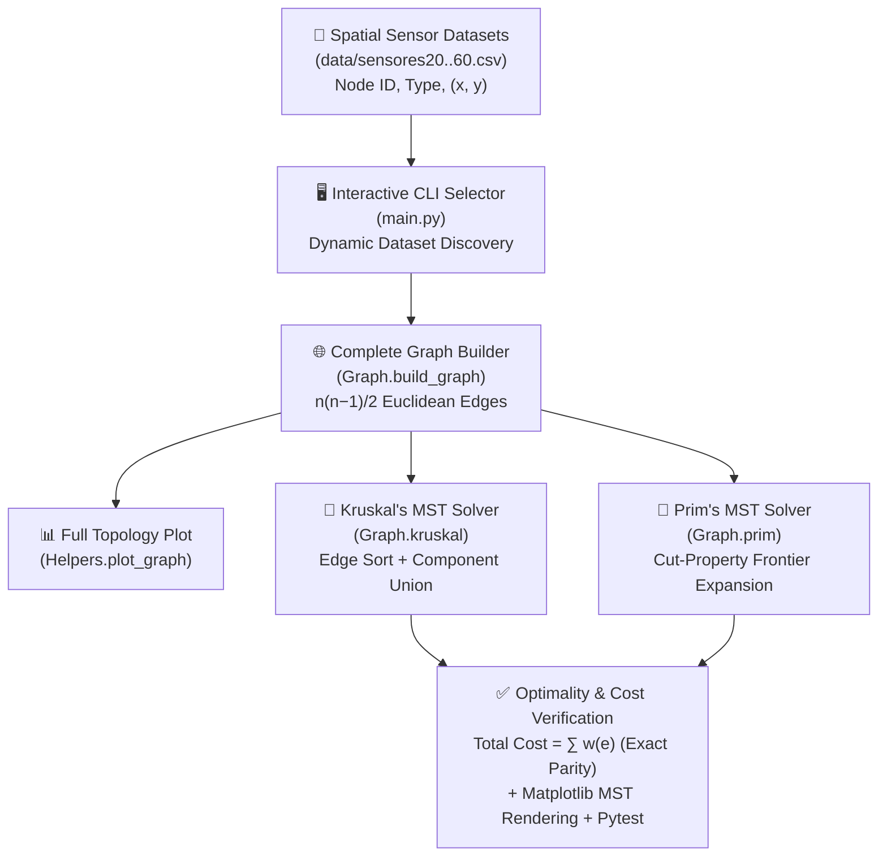

# Wireless Sensor Network Optimization
**Minimum Spanning Tree (Kruskal vs. Prim)**

> **A graph-theoretic combinatorial optimization framework in Python** designed to minimize physical cabling infrastructure, deployment cost, and transmission latency across geographically distributed Wireless Sensor Networks (WSNs). Developed for the *Graph Theory* (*Teoria dos Grafos*) course at **São Paulo State University (UNESP)**, the project models planar sensor topologies as weighted complete graphs and implements both **Kruskal's** and **Prim's** Minimum Spanning Tree (MST) algorithms from scratch, accompanied by step-by-step trace diagnostics, **Matplotlib** topology rendering, and a **pytest** automated unit test suite.

## 🔗 Quick Links

* **Source Code Repository:** [github.com/joaohb07/grafos-final](https://github.com/joaohb07/grafos-final)
* **Author:** João Henrique Botelho ([@joaohb07](https://github.com/joaohb07))
* **Course & Institution:** Graph Theory — UNESP

## 🏗️ System Architecture & Optimization Pipeline

The codebase follows a clean object-oriented separation of concerns across domain entities (`Sensor`), graph data structures and greedy MST solvers (`Graph`), and visualization/telemetry utilities (`Helpers`):



### Core Engineering Invariants

1. **Exact Global Optimum Parity:** Because all edge weights represent distinct or metric Euclidean distances in $\mathbb{R}^2$, both greedy algorithms are mathematically guaranteed by the **Cut Property** and **Cycle Property** of matroids/graphs to converge to the exact same minimum total cable length $W(T^*) = \sum_{e \in T^*} w(e)$ containing $|V| - 1$ edges.
2. **Modular Domain Decomposition:** Algorithmic logic (`Grafo.py`, `Sensor.py`) is strictly decoupled from I/O and plotting side effects (`Helpers.py`), enabling headless unit testing via `pytest` and `unittest.mock`.
3. **Multi-Scale Dataset Benchmarking:** Includes five spatial sensor benchmarks (`sensores20.csv`, `sensores25.csv`, `sensores34.csv`, `sensores45.csv`, and `sensores60.csv`) to evaluate spanning tree behavior across varying node densities ($|V| \in [20, 60]$).

## Graph Theory & Mathematical Formulation

### 1. Planar Euclidean Graph Model (`Graph.build_graph`)

Let $V = \{v_1, v_2, \dots, v_n\}$ denote the set of $n$ spatial sensor nodes and central base station, where each vertex $v_i$ is embedded in the Euclidean plane at coordinates $(x_i, y_i) \in \mathbb{R}^2$.

The network topology is modeled as an undirected, weighted **complete graph** $G = (V, E)$ with $|V| = n$ vertices and $|E| = \binom{n}{2} = \frac{n(n-1)}{2}$ candidate links, where the edge weight function $w: E \to \mathbb{R}_{>0}$ measures the Euclidean cable length between sensors $v_i$ and $v_j$:

$$
w(v_i, v_j) = \Vert{}v_i - v_j\Vert{}_2 = \sqrt{(x_i - x_j)^2 + (y_i - y_j)^2}
$$

### 2. Minimum Spanning Tree Objective

We seek an acyclic connected subgraph (spanning tree) $T = (V, E_T)$ with $E_T \subseteq E$ and $|E_T| = |V| - 1$ that minimizes total infrastructure length:

$$
\min_{T \subseteq G} W(T) = \sum_{e \in E_T} w(e) \quad \text{subject to } T \text{ spanning all } v \in V \text{ without cycles.}
$$

## Algorithmic Implementations & Complexity Analysis

### 1. Kruskal's Algorithm (`Graph.kruskal`) — Edge-Centric Greedy Selection

Kruskal's algorithm constructs the MST globally by sorting all $|E|$ candidate edges in non-decreasing order of Euclidean weight and iteratively adding the lightest edge that connects two disjoint connected components:

1. **Global Edge Sorting:** Sorts `self.edges` in ascending order of $w(e)$ in $\mathcal{O}(|E| \log |E|)$ time.
2. **Acyclic Component Merging:** Maintains a component representative dictionary `parent[node.node]` initialized to each node's own identifier. For each edge $(u, v, w)$:
   * If `parent[u] != parent[v]`, the edge does not induce a cycle; it is appended to `mst`, `total_cost` is incremented by $w$, and all vertices sharing `old_parent` are merged into `new_parent`.
   * Otherwise, the edge is discarded.
3. **Step-by-Step Telemetry:** Logs each accepted link `(u - v)`, edge weight, and cumulative cost via `Helpers.print_mst_step_by_step()`.

### 2. Prim's Algorithm (`Graph.prim`) — Vertex-Centric Frontier Expansion

Prim's algorithm grows a single connected tree outward from an arbitrary root node (`start_node = self.nodes[0]`) by repeatedly selecting the minimum-weight edge crossing the cut $(S, V \setminus S)$ between `visited_nodes` ($S$) and `unvisited_nodes` ($V \setminus S$):

1. **Initialization:** Sets $S = \{v_0\}$ and $U = V \setminus \{v_0\}$ (represented as Python hash sets `visited_nodes` and `unvisited_nodes`).
2. **Cut-Edge Selection:** While $U \neq \emptyset$, scans candidate edges incident to $S$ with at least one endpoint in $U$, selecting `nearest_edge` with minimum Euclidean distance.
3. **Tree Expansion:** Appends `nearest_edge` to `mst`, moves the newly reached endpoint(s) from `unvisited_nodes` to `visited_nodes`, and accumulates `total_cost`.

### 3. Theoretical Complexity & Structural Comparison

| Metric / Dimension | Kruskal's Algorithm (`Graph.kruskal`) | Prim's Algorithm (`Graph.prim`) |
| :--- | :--- | :--- |
| **Greedy Paradigm** | **Edge-centric** (global minimum weight edge across forest) | **Vertex-centric** (minimum weight edge across cut $(S, V \setminus S)$) |
| **Intermediate State** | Forest of disjoint trees merging into $1$ tree | Single connected tree expanding from root $v_0$ |
| **Asymptotic Time (Current Impl.)** | $\mathcal{O}(|E| \log |E| + |V|^2)$ (sort + linear array component merge) | $\mathcal{O}(|V|^2 \cdot |E|)$ (frontier scan over edge list) |
| **Optimal Asymptotic Bound** | $\mathcal{O}(|E| \log |E|)$ with Disjoint-Set Union (Union-Find + path compression) | $\mathcal{O}(|E| \log |V|)$ with Binary Min-Heap / $\mathcal{O}(|E| + |V| \log |V|)$ Fibonacci Heap |
| **Ideal Graph Topology** | **Sparse graphs** ($|E| \approx \mathcal{O}(|V|)$) | **Dense / Complete Euclidean graphs** ($|E| = \Theta(|V|^2)$) |

## Repository Structure & Datasets

```text
grafos-final/
├── classes/
│   ├── Grafo.py            # Graph representation, Euclidean metric, Kruskal & Prim MST solvers
│   └── Sensor.py           # Spatial sensor entity model (node ID, type, x, y coordinates)
├── helpers/
│   └── Helpers.py          # Matplotlib topology/MST plotters & step-by-step console formatters
├── data/
│   ├── sensores20.csv      # 20-node sensor network benchmark (190 candidate edges)
│   ├── sensores25.csv      # 25-node sensor network benchmark (300 candidate edges)
│   ├── sensores34.csv      # 34-node sensor network benchmark (561 candidate edges)
│   ├── sensores45.csv      # 45-node sensor network benchmark (990 candidate edges)
│   └── sensores60.csv      # 60-node sensor network benchmark (1,770 candidate edges)
├── tests/                  # Automated unit tests (pytest + unittest.mock)
├── main.py                 # Interactive CLI dataset selector & comparative execution driver
├── requirements.txt        # Python dependencies (matplotlib, numpy, pytest)
└── README.md               # Project overview & setup guide
```

### Spatial Dataset Schema (`data/*.csv`)

Each CSV dataset defines sensor coordinates and node roles (`Estacao` / `Sensor`):

```csv
node,type,x,y
S0,Estacao,50.0,50.0
S1,Sensor,12.4,84.1
S2,Sensor,78.9,31.5
...
```

## Setup, Execution & Automated Testing

### Prerequisites

* **Python 3.10+** (verified on Python 3.13)

### Installation & Interactive Execution

```bash
# Clone the repository
git clone https://github.com/joaohb07/grafos-final.git
cd grafos-final

# Create and activate a virtual environment
python3 -m venv venv
source venv/bin/activate

# Install dependencies
pip install -r requirements.txt

# Launch the interactive dataset menu
python3 main.py
```

### Sample Interactive CLI Session

```text
=== Selecione o dataset de sensores ===
  [1] sensores20.csv
  [2] sensores25.csv
  [3] sensores34.csv
  [4] sensores45.csv
  [5] sensores60.csv

Escolha o número do arquivo: 3

Carregando 'sensores34.csv'...

Passo a Passo do Algoritmo de Kruskal:
Adicionando Nó: S12 - S15, Distância: 4.12, Custo Total: 4.12
...
Custo Total (Kruskal): 342.87

Passo a Passo do Algoritmo de Prim:
Adicionando Nó: S0 - S4, Distância: 6.40, Custo Total: 6.40
...
Custo Total (Prim): 342.87
```

### Running the Unit Test Suite (`pytest`)

```bash
pytest -v
```

The test suite verifies Euclidean distance symmetry, complete edge generation ($|E| = \frac{n(n-1)}{2}$), spanning tree cardinality ($|E_T| = n - 1$), cycle absence, and exact total cost equivalence (`cost_kruskal == pytest.approx(cost_prim)`).