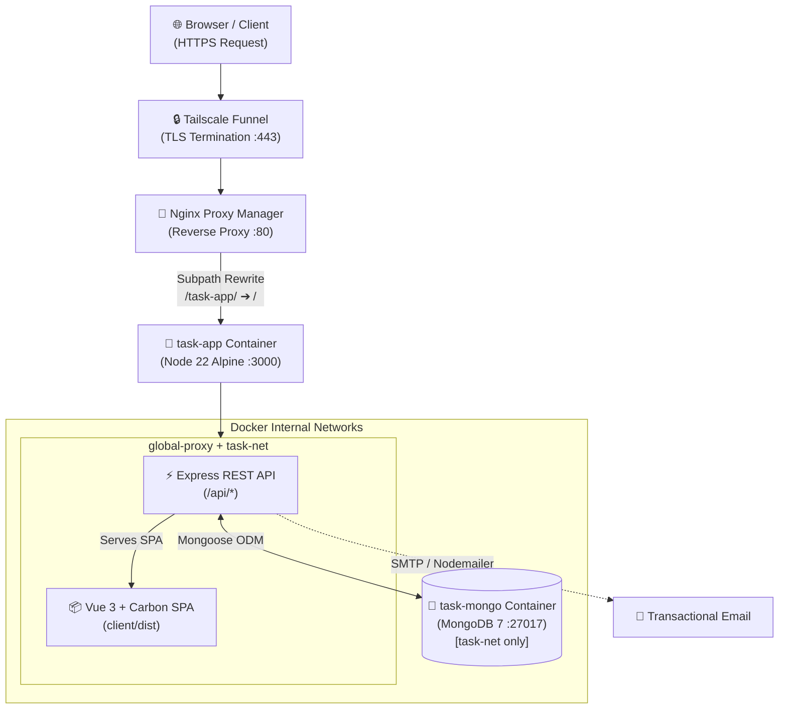
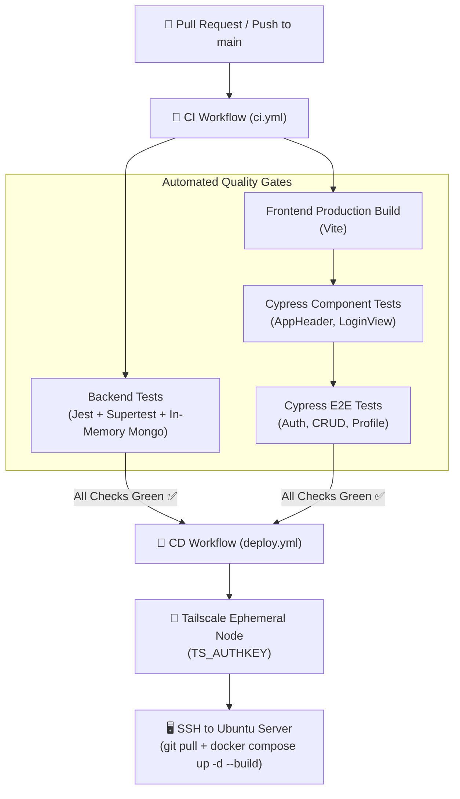

# Task App

<p align="left">
  <a href="https://jhbserver.tail4bcb71.ts.net/task-app/" target="_blank">
    
  </a>
  <a href="https://github.com/joaohb07/task-app" target="_blank">
    
  </a>
  
  
  
</p>

> **A containerized, Full Stack task management and user workspace platform** combining a Node.js/Express REST API, MongoDB document persistence, JWT session security, image processing, and a reactive Vue 3 + IBM Carbon Design System SPA — deployed with automated CI/CD to a self-hosted Ubuntu home server.

---

## Quick Links

* **Live Production App:** [https://jhbserver.tail4bcb71.ts.net/task-app/](https://jhbserver.tail4bcb71.ts.net/task-app/)
* **Source Code Repository:** [github.com/joaohb07/task-app](https://github.com/joaohb07/task-app)
* **API Collection:** `postman-collection.json` (available in the repository root)

---

## System Architecture & Infrastructure

The application runs as a decoupled, multi-container service inside a private Ubuntu home-lab environment, isolated across dedicated Docker bridge networks and securely exposed to the internet without opening router ports (bypassing CGNAT).



### Key Architectural Decisions

1. **Dual-Network Container Isolation (`global-proxy` vs. `task-net`):**
   * The `task-app` container attaches to both the shared `global-proxy` network (for reverse proxy ingress) and an isolated internal bridge network (`task-net`).
   * The `task-mongo` database container attaches **exclusively** to `task-net` with no host ports exposed, preventing external or cross-project network access to the database layer.
2. **Unified Single-Origin Deployment (Multi-Stage Docker):**
   * **Stage 1 (`frontend-builder`):** Compiles the Vue 3 + Vite + IBM Carbon bundle using relative asset resolution (`base: './'`) into static assets (`client/dist`).
   * **Stage 2 (`backend-builder`):** Installs lean production Node.js dependencies (`npm ci --omit=dev`).
   * **Stage 3 (`runtime`):** Runs on `node:22-alpine` under a non-root user (`USER node`), serving both the `/api` REST endpoints and the compiled SPA from a single origin on port `3000` — eliminating CORS overhead.
3. **Subpath Reverse Proxy Routing:**
   * Hosted under `/task-app/` via **Nginx Proxy Manager**, stripping the path prefix before forwarding requests to `http://task-app:3000`. Relative API paths in Axios (`baseURL: './api'`) and hash-based client routing (`createWebHashHistory()`) ensure seamless operation across both root (`localhost`) and subpath (`/task-app/`) environments.
4. **Zero-Trust Edge Ingress:**
   * **Tailscale Funnel** handles public DNS and automatic SSL/TLS certificate termination at the edge, forwarding clean HTTP traffic to Nginx without exposing the server's residential IP.

---

## Automated CI/CD Pipeline

Every pull request and merge to `main` is governed by a two-stage GitHub Actions workflow:



---

## Tech Stack & Engineering Breakdown

### Backend & Data Layer
* **Node.js (v22) & Express:** Modular REST API architecture separating routing (`src/routers`), authentication middleware (`src/middleware/auth.js`), data models (`src/models`), and transactional email utilities (`src/emails/account.js`).
* **MongoDB 7 & Mongoose:** Schema-level validation, virtual task relationships (`User.virtual('tasks')`), password hashing pre-save hooks (`bcryptjs`), and cascade deletion middleware removing all user tasks upon account deletion.
* **JWT Multi-Session Authentication:** Supports issuing multiple concurrent tokens per user, allowing single-session logout (`POST /api/users/logout`) or global session revocation across all devices (`POST /api/users/logoutAll`).
* **Multer & Sharp:** Validates uploaded avatar files (PNG/JPEG, max 1 MB) in memory and normalizes images to `250x250` PNG buffers stored directly in MongoDB.
* **Nodemailer:** Dispatches automated welcome and account cancellation emails via configurable SMTP transport.

### Frontend & Design System
* **Vue 3 (Composition API) & Vite:** Component-driven SPA with fast HMR in development and optimized static bundling in production.
* **Pinia & Vue Router:** Centralized reactive stores (`useAuthStore`, `useTaskStore`) paired with route navigation guards (`requiresAuth` / `guestOnly`).
* **IBM Carbon Design System (`@carbon/styles`, `@carbon/icons-vue`):** Structured enterprise UI featuring real-time KPI summary tiles, filterable/sortable/paginated data tables, inline task editing, responsive mobile navigation drawer, and dynamic Dark (`g100`) / Light (`g10`) theme switching.

### Quality Assurance & Automated Testing
* **Jest & Supertest (`mongodb-memory-server`):** Executes backend unit and HTTP integration tests against an isolated in-memory MongoDB instance with mocked SMTP calls.
* **Cypress (Component & E2E):** Validates isolated Vue components (`AppHeader`, `LoginView`) and full end-to-end user journeys (route protection, login/registration, task CRUD, filtering, and profile updates) using deterministic network interception (`cy.intercept`).

---

## API Reference

All REST endpoints are mounted under `/api`. Protected routes require a valid `Authorization: Bearer <token>` header. You can also import `postman-collection.json` from the repository root for ready-to-run requests.

### Users & Authentication

| Method | Endpoint | Auth | Description |
| :--- | :--- | :---: | :--- |
| `POST` | `/api/users` | No | Register a new user account and return user data + JWT token |
| `POST` | `/api/users/login` | No | Authenticate with email and password and return user data + JWT token |
| `POST` | `/api/users/logout` | Yes | Invalidate the token used in the current session |
| `POST` | `/api/users/logoutAll` | Yes | Clear all active session tokens for the authenticated user |
| `GET` | `/api/users/me` | Yes | Fetch the authenticated user's profile |
| `PATCH` | `/api/users/me` | Yes | Update allowed profile fields (`name`, `email`, `password`, `age`) |
| `DELETE` | `/api/users/me` | Yes | Delete the authenticated user account and trigger farewell email |

### User Avatars

| Method | Endpoint | Auth | Description |
| :--- | :--- | :---: | :--- |
| `POST` | `/api/users/me/avatar` | Yes | Upload a JPEG, JPG, or PNG image (up to 1 MB), resized to 250x250 PNG |
| `GET` | `/api/users/me/avatar` | Yes | Retrieve the authenticated user's PNG avatar binary |
| `GET` | `/api/users/:id/avatar` | No | Retrieve a user's PNG avatar binary by user ID |
| `DELETE` | `/api/users/me/avatar` | Yes | Remove the authenticated user's stored avatar |

### Tasks

| Method | Endpoint | Auth | Description |
| :--- | :--- | :---: | :--- |
| `POST` | `/api/tasks` | Yes | Create a task with description, optional details, `dueDate`, priority (`none`, `low`, `medium`, `high`), status (`todo`, `wip`, `done`), subtasks, completed, and validated tags IDs |
| `GET` | `/api/tasks` | Yes | List tasks with query filters (`completed`, `status`, `tag`, `priority`), sorting (`sortBy`, including `priority`), pagination (`limit`, `skip`), and stats (`total`, `completed`, `pending`) |
| `GET` | `/api/tasks/:id` | Yes | Fetch a single task owned by the authenticated user with populated tags |
| `PATCH` | `/api/tasks/:id` | Yes | Update description, details, `dueDate`, priority, status, subtasks, completed, or tags |
| `DELETE` | `/api/tasks/:id` | Yes | Delete a task owned by the authenticated user |

### Tags

| Method | Endpoint | Auth | Description |
| :--- | :--- | :---: | :--- |
| `POST` | `/api/tags` | Yes | Create a unique tag (`name`, optional `color`, default `'blue'`) for the user |
| `GET` | `/api/tags` | Yes | List user tags sorted by name with optional search, limit (default 50), and skip (default 0) |
| `PATCH` | `/api/tags/:id` | Yes | Update a tag's name (enforcing case-insensitive uniqueness per user) and/or color |
| `DELETE` | `/api/tags/:id` | Yes | Delete a tag and pull its reference from all tasks belonging to the user |

---

## Local Setup & Execution

### Prerequisites
* **Docker & Docker Compose**

### 1. Clone & Configure Environment

```bash
git clone https://github.com/joaohb07/task-app.git
cd task-app
```

Create a `.env` file in the root directory:

```env
PORT=3000
JWT_SECRET=your_super_secret_jwt_key
MONGODB_URL_DB=mongodb://task-mongo:27017/task-manager-api

# Optional SMTP configuration
SMTP_HOST=smtp.example.com
SMTP_PORT=587
SMTP_USER=your_smtp_user
SMTP_PASS=your_smtp_password
```

### 2. Run with Docker (Production Simulation)

```bash
# Create the shared reverse-proxy network if running for the first time
docker network create global-proxy

# Build the multi-stage image and start task-app + task-mongo
docker compose up -d --build
```

*(Note: To access directly at `http://localhost:3000` without a reverse proxy, uncomment the `ports` mappings in `docker-compose.yml`.)*

---

## Running the Test Suite

```bash
# Backend unit & integration tests (Jest + In-Memory MongoDB)
npm test

# Frontend Cypress Component Tests (headless)
npm run test:component

# Frontend Cypress E2E Tests (headless, requires dev/preview server on :5173)
npm run test:e2e
```