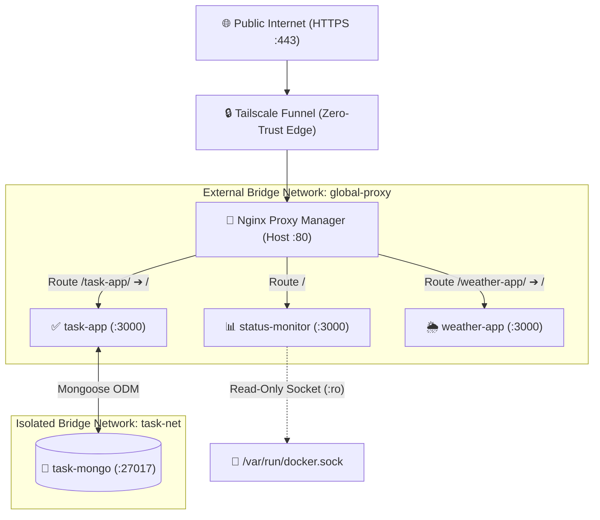

# My Server — Home-Lab Overview & Infrastructure

<p align="left">
  <a href="https://jhbserver.tail4bcb71.ts.net/" target="_blank">
    
  </a>
  <a href="https://github.com/joaohb07/status-monitor" target="_blank">
    
  </a>
  
  
  
</p>

> **A self-hosted private mini-cloud built on repurposed desktop hardware**, engineered to run containerized Full Stack applications, isolated databases, and automated CI/CD deployments behind a Zero-Trust reverse proxy edge — without opening router ports or exposing the host network.

---

## Quick Links

* **Live Home-Lab Portal & Telemetry:** [https://jhbserver.tail4bcb71.ts.net/](https://jhbserver.tail4bcb71.ts.net/)
* **Live Telemetry JSON API:** [https://jhbserver.tail4bcb71.ts.net/api/status](https://jhbserver.tail4bcb71.ts.net/api/status)
* **Status Monitor Repository:** [github.com/joaohb07/status-monitor](https://github.com/joaohb07/status-monitor)

---

## Hardware & OS Specifications

Repurposed consumer desktop hardware running headless in a 24/7 home-lab setup (`jhbserver`):

| Component | Specification | Role & Engineering Impact |
| :--- | :--- | :--- |
| **CPU** | Intel Core i5-7400 (4 cores @ 3.50 GHz) | Orchestrates concurrent Node.js containers, reverse proxy routing, and background jobs. |
| **Memory** | 16 GB DDR4 RAM | Provides ample headroom for multi-container stacks, MongoDB instances, and future local services. |
| **GPU** | NVIDIA GeForce GTX 1060 (3 GB VRAM) | Dedicated CUDA compute reserved for lightweight local LLM inference (e.g., Ollama). |
| **Storage** | 1 TB HDD (LVM) | Hosts OS, Docker images, persistent database volumes, and application repositories. |
| **Operating System** | Ubuntu Server 26.10 (`7.3.0-11-generic`) | Headless Linux environment with unattended security upgrades enabled. |

### Why Docker Compose Instead of Kubernetes?

For a **single-node home-lab**, running Kubernetes (`k3s` or `MicroK8s`) introduces significant RAM/CPU overhead just to sustain the control plane, alongside unnecessary complexity around CNI networking and persistent volume provisioning. **Docker Compose** paired with segmented bridge networks and Nginx Proxy Manager delivers declarative service orchestration, automatic container recovery (`restart: unless-stopped`), and near-zero resource overhead.

---

## Directory Topology & Network Segmentation

The server filesystem under `~/server` strictly separates **ingress infrastructure** from **application workloads**, while operational recovery scripts live in a dedicated utility folder:

```text
~/server/
├── proxy/                          # Ingress & Reverse Proxy Infrastructure
│   ├── docker-compose.yml          # Nginx Proxy Manager (:80 ingress, :81 admin)
│   ├── data/                       # Proxy hosts, custom locations, and access lists
│   └── letsencrypt/                # TLS certificates store
├── projects/                       # Self-Hosted Applications (Git + CI/CD targets)
│   ├── status-monitor/             # Root portal (/) & live telemetry API (/api/status)
│   ├── task-app/                   # Vue 3 + Express + MongoDB stack (/task-app/)
│   └── weather-app/                # React + Express weather intelligence (/weather-app/)
└── scripts/                        # Operational Automation
    └── restart-stack.sh            # Full-stack recovery & health verification script
```

### Docker Network Isolation (`global-proxy` vs. Private Bridges)



* **Shared Ingress Bridge (`global-proxy`):** Only web-facing containers attach to `global-proxy`. Because Nginx Proxy Manager resolves containers by service name over internal Docker DNS, application containers **never bind host ports** (`3000`, `27017`), eliminating port collisions.
* **Database Isolation (`task-net`):** Stateful services like `task-mongo` run exclusively on private per-project bridge networks, remaining completely unreachable from the reverse proxy or external networks.

---

## Security & Hardening Layers

The host and container runtime follow a defense-in-depth posture tailored for internet-exposed self-hosting:

1. **Host Firewall (`UFW`):** Default incoming policy set to `deny`. Only local LAN (`192.168.0.0/24`) access to SSH (`22/tcp`) and the NPM admin UI (`81/tcp`), plus VPN traffic on `tailscale0`, are permitted. Public ingress flows exclusively through the Tailscale Funnel interface.
2. **SSH Hardening (`sshd`):** Remote `root` login and password authentication are completely disabled (`PermitRootLogin no`, `PasswordAuthentication no`), enforcing Ed25519 key-based authentication for both administrative sessions and GitHub Actions CD runners.
3. **Unprivileged Container Execution:** Application images run under the restricted non-root `node` user (`USER node`) with `no-new-privileges:true`.
4. **Read-Only Docker Socket & Filesystem:** The `status-monitor` service mounts `/var/run/docker.sock` strictly as read-only (`:ro`) alongside a read-only root filesystem (`read_only: true`), preventing container mutation or daemon write access even if compromised.
5. **Automated Patch Management:** `unattended-upgrades` automatically applies critical kernel and OS security patches.