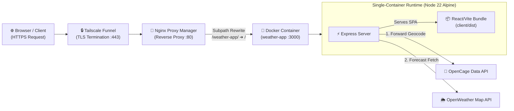

# Weather App
**Full Stack System Architecture**

<p align="left">
  <a href="https://jhbserver.tail4bcb71.ts.net/weather-app/" target="_blank">
    
  </a>
  <a href="https://github.com/joaohb07/weather-app" target="_blank">
    
  </a>
  
  
</p>

> **A containerized Full Stack weather intelligence platform** combining a non-blocking Node.js/Express REST API with a reactive React/Vite/Tailwind SPA, interactive `d3-geo` cartography, internationalization (`EN`/`PT`), and self-hosted reverse proxy infrastructure.

---

## 🔗 Quick Links

* **Live Production App:** [https://jhbserver.tail4bcb71.ts.net/weather-app/](https://jhbserver.tail4bcb71.ts.net/weather-app/)
* **Source Code Repository:** [github.com/joaohb07/weather-app](https://github.com/joaohb07/weather-app)

---

## 🏗️ System Architecture & Infrastructure

Unlike simple static deployments, this application is engineered to run as an isolated, production-grade microservice within a private Ubuntu home-lab cloud, exposed securely to the public internet without opening router ports (bypassing CGNAT).



### Key Architectural Decisions

1. **Unified Single-Origin Deployment (Multi-Stage Docker):**
   Instead of maintaining separate containers for frontend and backend (which introduces CORS overhead and network latency), the `Dockerfile` executes a 3-stage pipeline:
   * **Stage 1 (`frontend-builder`):** Compiles the React + Vite + Tailwind bundle with relative asset resolution (`base: './'`) into static assets (`client/dist`).
   * **Stage 2 (`backend-builder`):** Installs lean production-only Node.js dependencies (`npm ci --omit=dev`).
   * **Stage 3 (`runtime`):** Runs under a non-root `node` user on `node:22-alpine`, where Express serves both the `/weather` REST endpoint and the static SPA on port `3000`.
2. **Subpath Reverse Proxy Routing:**
   Hosted under the `/weather-app/` subpath via **Nginx Proxy Manager** over an internal Docker bridge network (`global-proxy`). Path-stripping rules and relative Vite asset paths ensure seamless routing alongside other hosted services on the same domain.
3. **Zero-Trust Edge Ingress:**
   External traffic is routed through **Tailscale Funnel**, handling automatic SSL/TLS termination at the edge and forwarding clean HTTP traffic to the internal reverse proxy.

---

## 🛠️ Tech Stack & Engineering Breakdown

### Backend & API Orchestration
* **Node.js (v22) & Express:** Lightweight, event-driven HTTP server exposing a unified `/weather` endpoint that orchestrates sequential external API calls (`Geocode ➔ Forecast`) with structured error handling and query sanitization.
* **OpenCage Data API:** Converts unstructured location queries (city names, addresses, landmarks) into standardized geographic coordinates (`latitude`, `longitude`, formatted location name).
* **OpenWeather Map API:** Retrieves real-time meteorological telemetry (temperature, feels-like, humidity, wind speed, weather conditions) supporting dynamic localization (`lang=en` / `lang=pt`).

### Frontend & Data Visualization
* **React & Vite:** Fast Single-Page Application (SPA) with component-driven architecture and development proxy forwarding (`/weather ➔ localhost:3000`).
* **Tailwind CSS:** Utility-first responsive styling engineered for clean visual hierarchy across desktop and mobile viewports.
* **d3-geo:** Renders interactive geographic map projections centered dynamically on the searched coordinates.
* **i18next (`react-i18next`):** Client-side internationalization engine seamlessly toggling UI labels and API weather descriptions between English and Portuguese.

### Quality Assurance & Automated Testing
* **Jest & Supertest:** Backend unit and HTTP integration tests validating API response contracts, query parameter validation (`400 Bad Request` on missing/invalid locations), and external service mocks.
* **Cypress:** Automated End-to-End (E2E) and component testing verifying user search flows, language switching, and UI state transitions against a running application instance.

---

## 📡 API Reference

### `GET /weather`

Resolves a location string and returns combined geolocation metadata and current weather telemetry.

**Query Parameters:**

| Parameter | Type | Required | Default | Description |
| :--- | :--- | :--- | :--- | :--- |
| `address` | `string` | **Yes** | — | City, region, or address to look up (e.g., `Porto, Portugal`). |
| `lang` | `string` | No | `en` | Response language code (`en` or `pt`). |

**Example Request:**
```bash
curl "https://jhbserver.tail4bcb71.ts.net/weather-app/weather?address=Porto&lang=en"
```

**Success Response (`200 OK`):**
```json
{
  "location": "Porto, Portugal",
  "latitude": 41.1494512,
  "longitude": -8.6107884,
  "forecastData": {
    "description": "clear sky",
    "temperature": 18.5,
    "feelsLike": 17.9,
    "humidity": 64
  }
}
```

---

## 🚀 Local Setup & Execution

### Prerequisites
* **Docker & Docker Compose** *(recommended)* or **Node.js v20+**
* API keys from [OpenCage](https://opencagedata.com/) and [OpenWeather](https://openweathermap.org/)

### 1. Clone & Configure Environment
```bash
git clone https://github.com/joaohb07/weather-app.git
cd weather-app
```

Create a `.env` file in the project root:
```env
PORT=3000
OPENCAGE_API_KEY=your_opencage_api_key
OPENWEATHER_API_KEY=your_openweather_api_key
```

### 2. Run with Docker (Production Simulation)
```bash
# Create the shared proxy network if running for the first time
docker network create global-proxy

# Build the multi-stage image and start the container
docker compose up -d --build
```
*(To access directly at `http://localhost:3000` without a reverse proxy, uncomment the `ports: - "3000:3000"` block in `docker-compose.yml`.)*

### 3. Run Natively (Development Mode)
```bash
# Install backend and frontend dependencies
npm install
npm --prefix client install

# Terminal 1: Start Express API (http://localhost:3000)
npm run dev

# Terminal 2: Start Vite Dev Server with API proxy (http://localhost:5173)
npm --prefix client run dev
```

---

## 🧪 Running the Test Suite

```bash
# Run backend unit & integration tests (Jest)
npm test

# Run Cypress End-to-End tests headlessly (requires dev server on :5173)
npx --prefix client cypress run

# Open Cypress interactive Test Runner
npx --prefix client cypress open
```